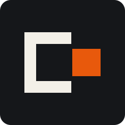

  

<h1 align="center">agy-delegate</h1>

<em>let the helper carry it</em>

agy-delegate lets Claude Code hand bulk reading and mechanical work to the Antigravity CLI (`agy`), so Claude's quota goes to the work that needs Claude. Claude stays in charge and reviews everything. It is one small app, a Claude Code plugin, and a router that picks the model for each job. It is a sibling of [Tailgate](https://github.com/TenTemujin/tailgate), which lists it in its catalog and shows what it saved.

## What is in it

| Where | What |
| --- | --- |
| **Overview** | Claude Code tokens per 5 h / 24 h / 7 d window, tokens saved by delegation, per-model share, helper outcomes. |
| **Activity** | Every delegated call with model, status, duration, helper tokens and estimated saving. |
| **Components** | Plugin switches (same as `/plugin`), agy status, safety rules, install and uninstall. |
| **Router** | Which model each kind of task goes to right now, and every model agy offers with its record. |
| **Updates** | Checks GitHub once a day. One click to update, or automatic. |
| **Settings** | Token budgets, Claude-models-inside-agy switch, every file the tool touches. |

## Install

**Desktop app (recommended).** Download from the [latest release](https://github.com/TenTemujin/delegate/releases/latest):

| Platform | File | First launch |
|---|---|---|
| Windows 10 / 11 | `agy-delegate-windows-x64.exe` | SmartScreen may warn (unsigned): *More info → Run anyway* |
| macOS | `agy-delegate-macos.zip` | Unzip, move to Applications, right-click → *Open* the first time (unsigned) |

Open it and press **Install everything**. That installs `agy` if it is missing (Google's official installer), applies
read-only safety rules to it, and enables the plugin in Claude Code. Restart Claude Code. If `agy` has never been signed
in, run `agy` once in a terminal.

Checksums for every file are in `SHA256SUMS` on the release page.

**From a clone (any OS, needs Python 3.8+).**

    ./install.sh                                            # macOS / Linux
    powershell -ExecutionPolicy Bypass -File install.ps1    # Windows

Then `python3 app.py` opens the app. On first run it sets up its window runtime (pywebview) in a private venv under
`~/.agy-delegate/venv`; if that is not possible it opens the same panel in the browser.

**Inside Claude Code only.**

    /plugin marketplace add TenTemujin/delegate
    /plugin install agy-delegate@agy-delegate-marketplace
    /agy-delegate:setup

## Use

Open the app (`agy-delegate-windows-x64.exe`, the macOS app, or `python3 app.py`). It is a native window with the same look as Tailgate: paper, ink and one signal orange. The tabs are the table above.

It only listens on `127.0.0.1`, rejects other `Host` headers, and requires a per-launch token for any change.

## How delegation works

The skill tells Claude when to delegate (large reads, summaries, mechanical edits, web lookups, side jobs) and when
not to (anything numerical, validation verdicts, git, small tasks). Claude calls the wrapper:

    agy-run.sh  -a extract -b 98000 "List every public function in src/solver.rs with a one-line purpose"
    agy-run.ps1 -Kind extract -Bytes 98000 "..."      # Windows

The **router** picks the model by task kind, using every model agy offers:

| kind | for | ladder |
|---|---|---|
| `quick` | file lists, one search, yes/no | Flash low → medium → high |
| `extract` | counts, names, values from big files | Flash medium → high → Claude / GPT-OSS fallbacks |
| `summarize` | summaries, overviews, doc drafts | Flash medium → high → Sonnet fallbacks |
| `edit` | mechanical edits, boilerplate (`-w`) | Flash medium → high → Sonnet / Opus fallbacks |
| `reason` | tracing logic, explaining behaviour | Flash high → Sonnet high → Opus high |

It skips a model agy does not offer, climbs when a model fails more than 30% of its last calls, and parks a model
whose provider quota is exhausted until the reported reset. Below 6 KB of input it answers "stay in Claude" (exit 3):
the round trip would cost more than it saves. The order comes from the [benchmark](docs/BENCHMARK.md).

## Safety

- Read-only by default (`--mode plan`); edits only with `-w`, on a branch, reviewed with `git diff`.
  Never `--dangerously-skip-permissions`.
- agy 1.3.6 matches permission rules against the **exact** command string (verified: `command(cat)` does not allow
  `cat README.md`), so headless agy cannot run shell commands with arguments. The wrapper has the helper use agy's
  built-in file tools instead. Deny rules for `rm`, `git push/commit/reset/checkout/clean`, `curl`, `wget`, `sudo` are
  still installed as a second line.
- Output capped at 20 KB. Claude treats it as an untrusted draft and spot-checks it; never for numbers, verdicts or git.
- Install is reversible: every settings key it changes is recorded with its previous value
  (`~/.agy-delegate/install-state.json`) and restored by Uninstall. Settings that are not valid JSON are never touched.

## Measured

- Accuracy and the model ladder: [docs/BENCHMARK.md](docs/BENCHMARK.md) (fixed fixtures, ground truth computed
  before any call, every miss listed).
- Claude-side savings on a real 229 KB file: ~57k tokens read directly vs ~0.5k delegated ([docs/VALIDATION.md](docs/VALIDATION.md)).
  Helper tokens are spent on Antigravity, not Claude, and are not comparable 1:1 in cost.

## Build

    python plugins/agy-delegate/scripts/test_agyctl.py                    # installer core
    python plugins/agy-delegate/skills/agy-delegate/scripts/test_router.py
    python test_monitor.py && python test_panel.py
    bash plugins/agy-delegate/skills/agy-delegate/scripts/test_wrapper.sh # fake agy
    powershell -File plugins/agy-delegate/skills/agy-delegate/scripts/test_wrapper.ps1
    bash tests/test_installers.sh                                         # real installers, temp home
    python bench/benchmark.py --models all --reps 3 --md docs/BENCHMARK.md   # real agy, uses quota
    python -m pip install -r packaging/requirements.txt && python packaging/build.py   # app + self-test

CI runs all of the above (except the benchmark) on Linux, macOS and Windows; pushing a `v*` tag builds both apps,
self-tests them and publishes a release with `SHA256SUMS`.

Layout: `app.py` (window) · `panel.py` + `panel.html` (UI server) · `monitor.py` (usage data) ·
`plugins/agy-delegate/` (Claude Code plugin: skill, wrappers, router, `scripts/agyctl.py` installer core) ·
`bench/` · `packaging/` · `tests/`.

Optional third-party add-ons, off by default and not validated here: [caveman](https://github.com/JuliusBrussee/caveman)
(`--with-caveman`) and [rtk](https://github.com/rtk-ai/rtk) (`--with-rtk`).

## Limits

The desktop apps are unsigned, so SmartScreen (Windows) and Gatekeeper (macOS) warn on first launch. Savings are an estimate and only for calls that passed `-b`. Unofficial; not affiliated with Google or Anthropic.

MIT licensed.
